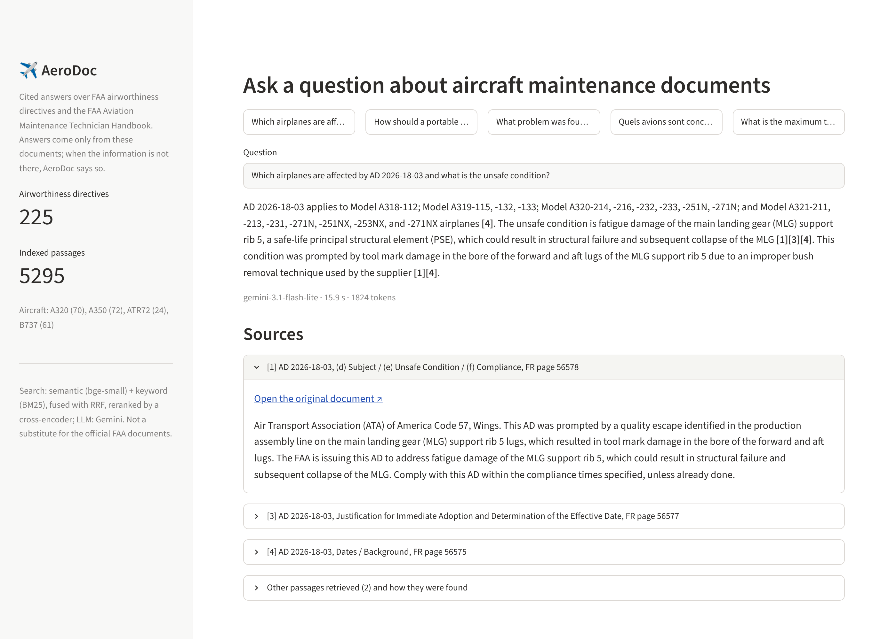

# AeroDoc

Retrieval-augmented assistant over **FAA airworthiness directives** and the **FAA Aviation Maintenance Technician Handbook**. Every statement in an answer cites its source (directive, section, page), and the assistant says it does not know when the answer is not in the documents.



## Run it

Requirements: [Docker Desktop](https://www.docker.com/products/docker-desktop/) and a free Gemini API key from [Google AI Studio](https://aistudio.google.com) ("Get API key").

```bash
git clone https://github.com/julesloisance-wq/aerodoc.git
cd aerodoc
cp .env.example .env        # then put your key after GEMINI_API_KEY=
docker compose up --build
```

Open **http://localhost:8501**. The first start downloads the corpus and builds the index (about 10 minutes, shown in the logs); later starts take a few seconds.

- API documentation: http://localhost:8000/docs (`POST /ask`, `POST /search`, `GET /health`, `GET /stats`)
- Database browser (optional): `docker compose --profile tools up adminer`, then http://localhost:8080

Command line (development, needs [uv](https://docs.astral.sh/uv/)): `make db`, `make data`, `make index`, `uv run aerodoc ask "..."`, `make eval`, `make test`.

## Results (held-out test set, 28 questions, run once)

| | LLM alone | Dense-only RAG | **AeroDoc** |
|---|---|---|---|
| Correct answers | 27 % | 50 % | **82 %** (95 % CI 62–93 %) |
| Made-up answers to unanswerable questions | 50 % | 0 % | **0 %** |
| Relevant passage retrieved (top 5) | – | 73 % | **91 %** |

Details: `EXPERIMENTS.md`. Full write-up and architecture: coming in the final version of this README.

> The code in this repository was written with an AI coding assistant (Claude Code). Jules Loisance designed the system, made the technical choices, validated the evaluation questions and analysed the results.
